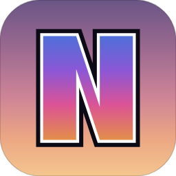

# NanoEdge

一个轻量的 Windows 浏览器，用 WPF (.NET Framework 4.8) + WebView2 构建，单 exe，无安装器。



## 特点

- **单文件**：Costura.Fody 内嵌依赖，WebView2Loader 从 exe 内释放，可直接拷贝运行
- **三种布局**：紧凑单行、标准两行、垂直标签（含悬浮展开）
- **三态内存治理**：Active / Low / Discarded，失焦降冷、后台丢弃、快照恢复、内存面板（工作集口径）
- **纯 WPF 内部页**：起始页、历史、书签、下载、设置、用户脚本管理；打开内部页不创建 WebView2
- **用户脚本**：Tampermonkey 子集（`@require`、`@match/@include/@exclude`、`GM_*` 子集、`@grant` 双端校验、按站点临时禁用）
- **浏览基础**：地址栏本地联想、历史/书签、按站点缩放、下载管理；Chrome/Edge 书签按 profile 选来源、看预览、确认后才导入；导出 HTML 保留文件夹层级；页内查找交给 WebView2 内置
- **密码自动填充**：直连 KeePassXC（宿主自己扮演浏览器端起 `keepassxc-proxy`，crypto_box 加密），地址栏出现钥匙图标 → 选账号 → 填进页面；**密码只在填充那一瞬间经过内存**，NanoEdge 不存密码、不写日志、不进快照
- **其他**：暗/亮主题、中/英双语、单实例 + 命名管道唤起、默认浏览器注册、崩溃恢复、最近关闭、favicon

## 系统要求

- Windows 10 1809+ / Windows 11，x64
- Microsoft Edge WebView2 Runtime（Windows 11 通常已内置；缺失时程序会提示下载地址）

## 构建

```powershell
dotnet build src/NanoEdge/NanoEdge.csproj -c Release
```

产物：`src/NanoEdge/bin/Release/net48/NanoEdge.exe`（单文件）。

## 运行

```powershell
.\src\NanoEdge\bin\Release\net48\NanoEdge.exe
```

常用命令行参数：

| 参数 | 说明 |
|---|---|
| `--open-url=<url>` | 启动后打开指定 URL |
| `--theme` | `dark` / `light` |
| `--layout` | `compact` / `standard` / `vertical` |
| `--lang` | `zh-CN` / `en-US` |
| `--screenshot=<path>` | 截图后退出 |

## 自测

仓库带真实 WebView2 自测，报告与截图写到 `out/`：

```powershell
.\src\NanoEdge\bin\Release\net48\NanoEdge.exe --m8test
```

历史自测参数：`--memtest`、`--navtest`、`--m3ctest`、`--m4test`、`--m5test`、`--m6test`、`--m6btest`、`--m7test`、`--m8test`、`--fixtest`（修复批次的针对性回归）。

## 文档

- [产品与技术 SPEC](docs/SPEC.md)

## 已知边界

- Chrome/Edge 导入**只导书签，暂不支持导入历史记录**（历史导入是下一批）；一次只导一个选中的 profile，不做多 profile 合并
- 密封标签只做应用层伪装（标题、地址栏、历史、会话、联想、缩放等），Cookie 与缓存仍写入共享的 WebView2 用户目录，**不是真正的无痕模式**
- 只支持单窗口多标签；不支持多窗口、标签拖出、Chrome 扩展
- 用户脚本的增删改与启停只在下次导航/刷新后生效
- 「8 个真实 dev 站点 ≤900MB」的内存目标尚未验收；本地轻量页基线见 SPEC 2.1
- 不带自动更新；需要系统已安装 WebView2 Runtime
- 密码填充只做「取出来填进去」：不保存新密码回库、不做 TOTP / passkey、不自动提交；**跨域 iframe 里的登录框不填**（避免把本站密码喂给第三方框架）；未开启 KeePassXC 的「浏览器集成」时整个功能不可用

## 第三方组件与许可

- 地址栏的密码填充图标使用 [KeePassXC](https://keepassxc.org/) 官方 logo，版权归 KeePassXC 项目所有，跟随其 **GPL-3.0** 许可
- 加密使用 [libsodium](https://libsodium.org/)（**ISC** 许可），通过 NuGet 包 `libsodium` 引入，运行时不联网
- 依赖 [Microsoft.Web.WebView2](https://learn.microsoft.com/microsoft-edge/webview2/)（BSD-3-Clause）、[Costura.Fody](https://github.com/Fody/Costura)（MIT）
